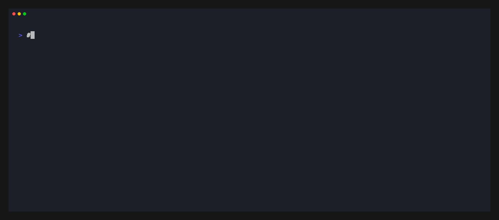

# MemVault

**Your agents forget between sessions. MemVault gives them one local, shared memory.**

Save a preference once. Claude Code, Codex, Cursor, and Obsidian can all recall it.
No account, no cloud dependency, no lock-in — the source of truth is one SQLite
file at `~/.memvault/data.db`.



## Start in 2 minutes

### 1. Install the binary

```bash
curl -fsSL https://raw.githubusercontent.com/dreamor/memvault/master/scripts/install.sh | bash
export PATH="$HOME/.memvault/bin:$PATH"
```

macOS/Linux installers also start the local REST backend. Verify it with
`memvault-cli status`.

### 2. Install the plugin

**Claude Code** (send these as two separate prompts):

```text
/plugin marketplace add dreamor/memvault
/plugin install memvault@memvault
```

**Codex**:

```bash
codex plugin marketplace add dreamor/memvault
```

Then install `memvault@memvault` from the plugin browser. On Codex, open
`/hooks` once and approve the `SessionStart` / `Stop` entries — hooks do not
run until trusted.

### 3. Prove recall works

In a session, say:

```text
Remember that I prefer pnpm over npm.
```

Open a **new** session and ask:

```text
What package manager do I prefer?
```

The new session should recall the preference before you mention it. If it does
not, run `/memvault-doctor` and follow its one-line fixes.

## What you get

| Piece | What it does |
|---|---|
| `SessionStart` hook | Recalls relevant memories into every new or resumed session automatically. |
| `Stop` hook (opt-in) | With `MEMVAULT_HOOK_EXTRACT=1`, distills durable learnings into the review inbox. Drafts never enter context until reviewed. |
| Outcome inference (opt-in) | With `MEMVAULT_HOOK_OUTCOME=1`, records whether a task succeeded, partially succeeded, or failed, so lessons can inform later work. |
| `SessionEnd` hook (on by default) | Closes the compliance rows the session opened: with an LLM extractor configured each injected memory is judged followed/violated/unknown, without one the rows are closed as `unknown`. Disable with `MEMVAULT_HOOK_COMPLIANCE=0`. |
| `memvault` MCP server | 20 tools (`save_memory`, `search_memory`, `session_start`, `review_memory`, …) plus the `memory://user-profile` and `memory://project-context` resources. |
| Skills | `memvault-recall`, `memvault-save`, `memvault-review`, `memvault-sync` — invoked by the model when relevant. |
| Commands | `/memvault-review`, `/memvault-save`, `/memvault-sync`, `/memvault-doctor`. |

## Your data and permissions

MemVault is deliberately boring about trust:

- **Reads:** the host's hook payload (session id, working directory, prompt
  metadata, or transcript path). When end-of-session extraction is enabled, it
  reads the transcript file the host passes to the `Stop` hook.
- **Writes:** `~/.memvault/data.db` (memories, review inbox, episodes and
  history), plus server PID/log files under `~/.memvault` when the local REST
  backend is running.
- **Does not:** create an account, upload your memory store, or require a
  cloud service. The REST backend binds to loopback and stores everything in
  the SQLite file above.
- **Turn it off:** set `MEMVAULT_HOOK_EXTRACT=0` / `MEMVAULT_HOOK_OUTCOME=0`
  (or unset them), or disable/remove the plugin. Existing data remains a local
  SQLite file you can inspect, back up, or delete.
- **Review boundary:** automatic extraction writes unreviewed drafts. Only
  approved memories are injected by the normal recall path.

## Commands

| Command | Purpose |
|---|---|
| `/memvault-doctor` | Check CLI, plugin version, MCP handshake, REST health, database, hooks and embeddings; report one fix per failure. |
| `/memvault-review` | Approve, edit or reject pending memory drafts. |
| `/memvault-save` | Save the current session's durable learnings. |
| `/memvault-sync` | Generate `AGENTS.md`, `CLAUDE.md`, or Copilot rule files for hosts without hooks. |

## Install details

### Claude Code

```text
/plugin marketplace add dreamor/memvault
/plugin install memvault@memvault
```

### Codex

Codex reads the same bundle through its own marketplace:

```bash
codex plugin marketplace add dreamor/memvault
```

Then install `memvault@memvault` from the plugin browser, or enable it in the
project's `.codex/config.toml`:

```toml
[plugins."memvault@memvault"]
enabled = true
```

Two Codex-specific notes:

- **Self-healing backend.** The `SessionStart` hook also runs
  `hooks/ensure-server.sh`, which calls the idempotent
  `memvault-cli server start --quiet` when the REST backend is not answering.
  A reboot fixes itself the next time you start a session. The probe also
  replaces a backend left over from an older release.
- **Host identity comes from the payload.** `MEMVAULT_AGENT_ID` wins, then
  `CODEX_*` in the environment, then the hook payload itself. Codex Desktop
  starts plugin hooks without `CODEX_*`, so the payload (`turn_id`, a Codex
  rollout transcript, or Codex-specific fields) is the reliable signal.
- **Trust the hooks once.** Codex runs plugin hooks only after approval. An
  untrusted hook is listed but skipped. Approve the bundled `SessionStart` /
  `Stop` entries in `/hooks`; the review is pinned to script hashes, so
  editing a hook asks again.
- **Single plugin manifest.** The bundle ships only
  `.claude-plugin/plugin.json`, which Claude Code and Codex both read. Do not
  add a plugin-root `plugin.json`: on Codex `0.163.0-alpha.11.1` its presence
  stops default `hooks/hooks.json` discovery. `tests/run-tests.sh` and CI
  enforce this. The same manifest carries the Codex listing metadata
  (`displayName`, `brandColor`, `composerIcon`, `logo`, `websiteURL`).

## Environment

| Variable | Default | Meaning |
|---|---|---|
| `MEMVAULT_AGENT_ID` | `codex` under Codex, else `claude-code` | Agent identity for scoped injection and stamped drafts. The id must have an entry in `~/.memvault/agents.yaml`; an unknown id falls back to `default`, whose `namespace_filter` is global-only, so project memories would not be injected. |
| `MEMVAULT_HOOK_EXTRACT` | `0` | `1` = extract memory drafts at session end (they go to the review inbox, never straight into context). |
| `MEMVAULT_HOOK_OUTCOME` | `0` | `1` = infer a task outcome at session end and record it as an episode. Independent of `MEMVAULT_HOOK_EXTRACT`. |
| `MEMVAULT_HOOK_COMPLIANCE` | `1` | `1` = at `SessionEnd`, finalize the pending compliance rows for this session (judged followed/violated when an LLM extractor is configured, otherwise `unknown`). `0` leaves them pending. |
| `MEMVAULT_HTTP_URL` | `http://127.0.0.1:3777` | REST backend used when the CLI is unavailable (`memvault-mcp --transport http`). |
| `MEMVAULT_BIN` | — | Explicit path to the `memvault`/`memvault-cli` binary, for non-interactive shells missing `~/.memvault/bin`. |
| `MEMVAULT_HOOK_DEBUG` | `0` | `1` = append hook diagnostics to `${TMPDIR:-/tmp}/memvault-hook.log`. |

These are **hook-process** variables: set them in the environment your host
launches hooks with. `~/.memvault/.env` is only read by the CLI/MCP binaries,
not by the hook scripts, and Codex/Claude `hooks.json` has no per-hook `env`
block — so a GUI-launched Codex that misdetects its host needs the variable
exported at the app level (e.g. `launchctl setenv MEMVAULT_AGENT_ID codex` on
macOS).

Hooks **never fail your session**: if neither the CLI nor an HTTP backend
answers they exit 0 and the MCP server still works once you fix the environment.
They are not silent, though — one diagnostic line goes to stderr on failure, so
an outage is visible without `MEMVAULT_HOOK_DEBUG=1`.

## Notes

- The bundled MCP server runs `memvault-mcp --transport stdio`; it must be on
  your `PATH`. If your client does not pick it up, register it manually:
  `claude mcp add memvault -- memvault-mcp --transport stdio`.
- Rule files for hosts without hooks or MCP (`AGENTS.md`, `CLAUDE.md`, …) can
  be generated with `memvault-cli sync` — see the `memvault-sync` skill.
- After the bundle changes in this repo, refresh Codex's cached copy with
  `scripts/refresh-codex-plugin.sh` (idempotent; upgrades the marketplace
  snapshot and reinstalls `memvault@memvault`); changed hook scripts re-require
  `/hooks` trust. End users can run `codex plugin marketplace upgrade memvault`
  and reinstall from the plugin browser.
- On Codex, confirm the hooks actually loaded before debugging anything else:
  they must appear as plugin hooks in `/hooks`. If they are absent, verify the
  installed bundle contains `.claude-plugin/plugin.json` and
  `hooks/hooks.json` but **no** plugin-root `plugin.json`.
